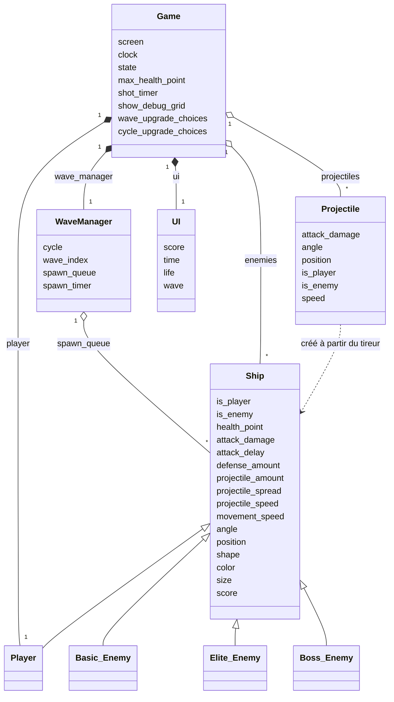

# Rapport Projet Programmation

*Alex Papiccio, Arsène Leblois*

**Dépôt GitHub :** <https://github.com/Oliphantaupe/circular-space-invaders>

**Programme initial :** <https://github.com/attreyabhatt/Space-Invaders-Pygame>

## 1. Analyse du programme initial

Le programme initial est un Space Invaders classique écrit en un seul fichier `main.py` (environ 180 lignes) : le joueur se déplace de gauche à droite en bas de l’écran, six ennemis descendent en zigzag, et le joueur leur tire dessus.

Principales limitations :

- **Aucune classe, tout est en variables globales.** Le joueur est représenté par des variables séparées (`playerX`, `playerY`, `playerX_change`), et les ennemis par des listes parallèles (`enemyX`, `enemyY`, `enemyX_change`, `enemyY_change`, `enemyImg`) reliées seulement par leur indice `i`. Ajouter une statistique à un ennemi (des points de vie par exemple) demande une nouvelle liste à garder synchronisée avec les autres.
- **Un seul type d’ennemi et un seul projectile.** Le tir est géré par une seule balle et un état texte (`bullet_state = "ready"` / `"fire"`) : impossible de tirer plusieurs projectiles à la fois, et donc d’ajouter un tir multiple ou des ennemis qui tirent sans réécrire cette partie.
- **Logique, entrées et affichage mélangés dans la boucle principale.** La même boucle lit le clavier, déplace les ennemis, teste les collisions et dessine. La fonction `fire_bullet` modifie l’état du jeu (via `global`) *et* dessine la balle.
- **Valeurs écrites en dur.** Les nombres comme `736`, `480`, `440`, `27` (distance de collision) ou `4` et `40` (vitesses) sont répétés dans le code et dépendent de la taille de la fenêtre (800×600) et des images. Changer l’équilibrage ou la taille d’un sprite oblige à retrouver chaque nombre.
- **Vitesse liée au nombre d’images par seconde.** Les déplacements se font en pixels par image, sans horloge : le jeu va plus ou moins vite selon l’ordinateur.
- **Pas d’états de jeu.** Le game over est obtenu en déplaçant tous les ennemis à `y = 2000` pour les sortir de l’écran ; il n’y a ni pause, ni écran de fin propre, ni redémarrage.
- **Pas de progression.** Un ennemi touché réapparaît en haut : pas de vagues, pas de difficulté croissante, pas d’améliorations.

Il est difficile à faire évoluer parce que chaque nouvelle fonctionnalité oblige à modifier la boucle principale à plusieurs endroits en même temps, et que les données d’un même objet sont dispersées dans plusieurs variables globales. Il n’y a aucun endroit unique où lire ou régler les caractéristiques d’un vaisseau.

## 2. Architecture proposée

Nous avons gardé l’idée de départ (un jeu de tir pygame) mais l’avons transformée : les ennemis arrivent de toutes les directions, le joueur se déplace avec Z/Q/S/D et vise à la souris, le jeu est découpé en vagues et en cycles de plus en plus difficiles, avec des améliorations à choisir.

Le code est réparti en modules, chacun avec une responsabilité :

| Fichier | Responsabilité |
|---|---|
| `main.py` | Boucle de jeu et lecture des touches |
| `game/game_class.py` | Classes des vaisseaux (`Ship` et ses sous-classes), `Projectile`, `UI` |
| `game/game_content.py` | Contenu du jeu : vagues, listes d’améliorations, `apply_upgrade`, `spawn_wave` |
| `game/game_state.py` | État d’une partie en cours : `WaveManager`, `Game` |
| `game/game_logic.py` | Comportement : déplacements, tirs, collisions, vagues et cycles |
| `game/rendering.py` | Affichage |
| `game/assets.py` | Chargement des images, sons, musique et police du dossier `assets/` (crédits dans `assets/CREDITS.md`) |

### Diagramme de classes



- **Héritage :** `Player`, `Basic_Enemy`, `Elite_Enemy` et `Boss_Enemy` héritent de `Ship`.
- **Composition :** une partie (`Game`) possède un joueur, un gestionnaire de vagues et une interface ; ils sont créés avec elle et disparaissent avec elle.
- **Agrégation :** `Game` contient les listes des ennemis et des projectiles présents à l’écran, et `WaveManager` la liste des ennemis de la vague pas encore apparus.
- **Dépendance :** un `Projectile` est construit à partir du vaisseau qui tire.

## 3. Justification des choix

### Variables / Constantes:

Les réglages du jeu qui ne sont pas des statistiques de vaisseau sont des constantes en début de `game_logic.py`, pour être modifiés sans toucher à la logique :

- `SPAWN_RADIUS` (400) : distance du joueur à laquelle les ennemis apparaissent.
- `SPAWN_DELAY` (0.5) : secondes entre l’apparition de deux ennemis d’une même vague.
- `WAVE_END_HEAL` (0.20) : part de la vie maximale rendue au joueur à la fin de chaque vague.
- `UPGRADES_OFFERED` (3) : nombre d’améliorations proposées au choix.
- `PROJECTILE_SIZE` (5) : rayon de collision d’un projectile.
- `MOVE_KEYS` : dictionnaire touche → direction de déplacement (Z/Q/S/D et flèches).

### Structures de données:

- **`Waves`** : Liste du contenu des vague, chaque élément de la ligne désigne une vague et son contenu est un dictionnaire qui indique l’ID de chaque ennemi et le nombre qui doit apparaître.
- **`Wave_upgrades`** : Liste des améliorations qui seront accordées à chaque fin de vague.
- **`Cycle_upgrades`** : Liste des améliorations qui seront accordées à chaque fin de cycle.
- **`enemies`** et **`projectiles`** (dans `Game`) : listes des ennemis et projectiles présents à l’écran. Chaque image, elles sont reconstruites sans les ennemis morts ni les projectiles utilisés ou sortis de l’écran.
- **`spawn_queue`** (dans `WaveManager`) : liste des ennemis créés par `spawn_wave` qui n’ont pas encore été placés à l’écran.

### Classes / Attributs:

#### `Ship`:

- `is_player`: valeur booléenne désignant si le vaisseau est joueur (True est joueur/ False ne l’est pas)
- `is_enemy`: valeur booléenne désignant si le vaisseau est ennemi (True est joueur/ False ne l’est pas)
- `health_point`: valeur à virgule flottantes qui indique le nombre de point de vie du vaisseau.
- `attack_damage`: valeur à virgule flottantes qui indique le nombre de dégat du vaisseau.
- `attack_delay`: valeur à virgule flottantes qui indique le delai entre chaque tir du vaisseau.
- `defense_amount`: valeur à virgule flottantes qui indique la reduction de dégâts subis par le vaisseau.
- `projectile_amount`: valeur entière qui indique le nombre de projectile tirer par le vaisseau.
- `projectile_spread`: valeur entière qui indique l’écart entre les projectiles tirés par le vaisseau.
- `projectile_speed`: valeur à virgule flottantes qui indique la vitesse du projectile tirer par le vaisseau.
- `movement_speed`: valeur à virgule flottantes qui indique la vitesse de déplacement du vaisseau.
- `angle`: valeur entière qui indique l’angle de rotation du vaisseau.
- `position`: liste de valeurs entières qui indique la position du vaisseau.
- `shape`: chaine de caractères qui indique la forme du vaisseau.
- `color`: valeur RGB qui détermine la couleur du vaisseau.
- `size`: valeur entière qui indique la taille du vaisseau.
- `score`: valeur entière qui indique le score du vaisseau.

`Player` hérite de la classe vaisseau, ce sera le vaisseau contrôler par le joueur.

`Basic_Enemy`, `Elite_Enemy` et `Boss_Enemy` héritent de la classe vaisseau, ils n’utilisent pas les attributs liés aux projectiles mais ils sont laissés volontairement en prévision qu’on ajoute la fonctionnalité aux ennemis de tirer.

La classe projectile permet de créer un projectile à partir des valeurs du vaisseau tireur (définit en tant que `.shooter`), elle réutilise ses valeurs de projectiles, son angle pour savoir dans quelle direction se déplacer et utilise une copie de la position du vaisseau tireur pour apparaître à sa position et continuer son chemin à partir de celle-ci sans pour autant écraser l’adresse mémoire.

La classe UI contient l’ensemble des éléments à afficher en temps réel dans l’interface.

Life et Score peuvent être récupérer à partir du vaisseau Joueur.Time est calculer depuis le lancement de la partie et Wave indique le nombre de vague d’ennemis vaincu qui est incrémenter en tant que compteur à chaque vague réussie.

#### `WaveManager`

Suit l’avancement dans les vagues : le cycle en cours (`cycle`), la vague en cours (`wave_index`), les ennemis qui restent à faire apparaître (`spawn_queue`) et le temps avant le prochain (`spawn_timer`).

#### `Game`

Regroupe tout l’état d’une partie : la fenêtre, le joueur, les ennemis, les projectiles, le gestionnaire de vagues et l’interface. Elle contient aussi ce qui n’appartient à aucun vaisseau :

- `state` : l’état du jeu (`"playing"`, `"wave_upgrade"`, `"cycle_summary"`, `"game_over"`). Seul l’état `"playing"` fait avancer le jeu, ce qui met la partie en pause pendant le choix d’une amélioration.
- `max_health_point` : la vie maximale du joueur, nécessaire pour le soin de fin de vague, puisque `health_point` est la vie actuelle.
- `shot_timer` : le temps avant que le joueur puisse tirer à nouveau.
- `wave_upgrade_choices` et `cycle_upgrade_choices` : les améliorations tirées au hasard proposées au joueur.

Redémarrer une partie consiste simplement à créer un nouvel objet `Game`.

### Fonctions / Méthodes:

- **`Apply_upgrade`** : cette fonction prend en paramètre ; le vaisseau Joueur et l’id de l’amélioration à appliquer. Appeler cette fonction permet d’appliquer une amélioration, l’effets des améliorations sont définis directement à l’interieur de cette fonction, cela permet d’appliquer des améliorations potentiellement plus complexes avec des formules plutôt que d’être coincer à un simple ajout de statistique stockée dans une structure de donnée. Cette fonction ne retourne rien.
- **`Spawn_wave`** : cette fonction prend en paramètre ; le contenu de la vague (dictionnaire, enemy_id : nombre d’ennemi), le cycle (valeur entière qui incrémente une fois toutes les vagues terminées) et la position d’apparition des ennemis, `random.choice` peut être utiliser pour choisir des positions d’apparition aléatoire à partir d’une liste. Le nombre d’ennemis et leurs puissance est calculer à partir du cycle.
- Les fonctions de **`game_logic.py`** sont regroupées par rôle : géométrie (`point_at`, `move`, `angle_towards`, `collides`), vie du joueur (`damage_player`, `heal_player`, `upgrade_player`), vagues et cycles (`start_next_wave`, `update_wave_manager`, `start_next_cycle`), joueur (`move_player`, `aim_player`, `shoot`) et monde (`update_projectiles`, `update_enemies`, `handle_collisions`). `update_playing` les appelle dans l’ordre à chaque image.

### Choix architecturaux

- **Les classes contiennent les données, les fonctions contiennent le comportement.** Les classes de `game_class.py` décrivent ce qu’est un vaisseau (ses statistiques) et les fonctions de `game_logic.py` décrivent ce qu’il fait. Cela permet de régler l’équilibrage sans risquer de casser la logique, et de travailler à deux en parallèle : l’un sur le contenu, l’autre sur la logique.
- **Héritage de `Ship`.** Tous les vaisseaux partagent les mêmes attributs, définis une seule fois. Les sous-classes ne font que donner leurs valeurs. Le joueur et les ennemis sont traités par les mêmes fonctions (déplacement, collision, affichage).
- **Le projectile copie les valeurs du tireur au moment du tir.** Une amélioration choisie plus tard ne modifie pas les projectiles déjà en vol, et la copie de la position évite que le projectile et le vaisseau partagent la même liste en mémoire.
- **Les vagues contiennent directement les classes d’ennemis.** `spawn_wave` crée les ennemis à partir de ces classes et calcule leur puissance selon le cycle. La même fonction sert à afficher les statistiques des ennemis du cycle suivant sur l’écran de fin de cycle : la formule de difficulté n’existe qu’à un seul endroit.
- **Vie maximale suivie par la partie.** Comme les améliorations multiplient `health_point`, la vie maximale est multipliée du même facteur : « health up » à 50/100 donne 55/110.
- **Score multiplié par le cycle.** Un ennemi rapporte son `score` multiplié par le numéro du cycle, car il est plus résistant.
- **Déplacements en fonction du temps.** Les vitesses sont en pixels par seconde et multipliées par le temps écoulé depuis l’image précédente : le jeu va à la même vitesse sur tous les ordinateurs, contrairement au programme initial.
- **Affichage séparé.** `rendering.py` ne fait que lire l’état et dessiner. La forme d’un vaisseau vient de son attribut `shape` (`"circle"` ou `"triangle"`), et un triangle pointe dans la direction de son `angle`.

## 4. Extensibilité

- **Ajouter un type d’ennemi :** créer une sous-classe de `Ship` avec ses valeurs dans `game_class.py`, puis l’utiliser dans `waves`. Aucune autre ligne à modifier : il apparaît, se déplace, entre en collision, est affiché et voit sa puissance augmenter avec les cycles automatiquement.

  ```python
  class Fast_Enemy(Ship):
      def __init__(self, position: list[float]):
          super().__init__(
              is_enemy = True,
              health_point = 5,
              attack_damage = 5,
              movement_speed = 150,
              position = position,
              shape = "triangle",
              color = (0, 255, 255),
              size = 10,
              score = 15,
          )
  ```

  ```python
  waves = [
      {Basic_Enemy: 5, Fast_Enemy: 3}, #wave 1
      ...
  ]
  ```

- **Ajouter une amélioration :** ajouter son nom dans `wave_upgrades` ou `cycle_upgrades` et son effet dans `apply_upgrade`. Elle est automatiquement proposée au joueur et affichée.
- **Faire tirer les ennemis :** les ennemis ont déjà tous les attributs de tir, et un `Projectile` garde `is_player` et `is_enemy` de son tireur. Les collisions vérifient déjà que seuls les projectiles du joueur touchent les ennemis. Il faudrait que la fonction `shoot`, écrite aujourd’hui pour le joueur, reçoive le vaisseau qui tire, donner à chaque ennemi son propre délai avant le prochain tir, et ajouter dans `handle_collisions` le cas d’un projectile ennemi qui touche le joueur.
- **Ajouter une forme de vaisseau :** ajouter un cas dans `draw_ship` (`rendering.py`), puis l’utiliser dans l’attribut `shape` d’une classe.
- **Changer les règles du jeu :** distance d’apparition, délai entre les ennemis, soin de fin de vague ou nombre d’améliorations proposées sont des constantes en début de `game_logic.py`.

## 5. Limites

- **Le comportement n’est pas dans les classes.** Comme les classes ne contiennent que des données, donner un comportement propre à un type d’ennemi (un boss qui fonce par exemple) demande d’ajouter une condition dans `game_logic.py` plutôt que de redéfinir une méthode dans sa classe. *Amélioration possible :* une méthode `update` dans `Ship`, redéfinie par les sous-classes qui se comportent différemment.
- **`apply_upgrade` grandit avec chaque amélioration**, et les améliorations sont identifiées par des chaînes de caractères : une faute de frappe dans un nom n’est détectée qu’au moment où l’amélioration est choisie (`ValueError`). *Amélioration possible :* une classe par amélioration avec une méthode `apply`.
- **`is_player` et `is_enemy` répètent ce que dit déjà la classe** et peuvent se contredire : `Boss_Enemy` n’indiquait pas `is_enemy = True` au départ.
- **Les ennemis portent des attributs qu’ils n’utilisent pas encore** (`attack_delay`, `projectile_amount`…), à `None`.
- **La vie maximale est stockée dans `Game`** et non dans le vaisseau, parce que `Ship` n’a qu’un seul attribut de vie.
- **La position donnée à `spawn_wave` est recalculée** au moment où l’ennemi apparaît, car le joueur a pu bouger entre la création de la vague et l’apparition de l’ennemi.
- **Les collisions testent chaque ennemi contre chaque projectile.** C’est suffisant pour le nombre d’ennemis actuel, mais deviendrait lent avec des centaines d’objets.
- **Pas de tests automatisés** dans le dépôt : les vérifications ont été faites en jouant et avec des scripts de test non versionnés.
