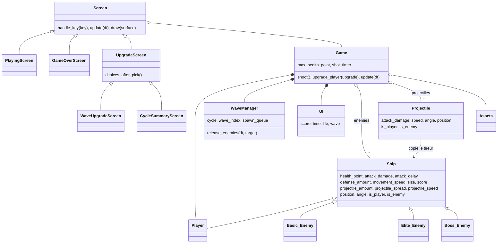

# Rapport Projet Programmation

*Alex Papiccio, Arsène Leblois*

**Dépôt GitHub :** <https://github.com/Oliphantaupe/circular-space-invaders>

**Programme initial :** <https://github.com/attreyabhatt/Space-Invaders-Pygame>

## 1. Analyse du programme initial

Le programme initial est un Space Invaders classique écrit en un seul fichier `main.py` (environ 180 lignes) : le joueur se déplace de gauche à droite en bas de l’écran, six ennemis descendent en zigzag, et le joueur leur tire dessus.

Principales limitations :

- **Aucune classe, tout est en variables globales.** Le joueur est représenté par des variables séparées (`playerX`, `playerY`, `playerX_change`), et les ennemis par des listes parallèles (`enemyX`, `enemyY`, `enemyX_change`, `enemyY_change`, `enemyImg`) reliées seulement par leur indice `i`. Ajouter une statistique à un ennemi (des points de vie par exemple) demande une nouvelle liste à garder synchronisée avec les autres.
- **Un seul type d’ennemi et un seul projectile.** Le tir est géré par une seule balle et un état texte (`bullet_state = "ready"` / `"fire"`) : impossible de tirer plusieurs projectiles à la fois, et donc d’ajouter un tir multiple ou des ennemis qui tirent sans réécrire cette partie.
- **Logique, entrées et affichage mélangés dans la boucle principale.** La même boucle lit le clavier, déplace les ennemis, teste les collisions et dessine. La fonction `fire_bullet` modifie l’état du jeu (via `global`) *et* dessine la balle.
- **Valeurs écrites en dur.** Les nombres comme `736`, `480`, `440`, `27` (distance de collision) ou `4` et `40` (vitesses) sont répétés dans le code et dépendent de la taille de la fenêtre (800×600) et des images.
- **Vitesse liée au nombre d’images par seconde.** Les déplacements se font en pixels par image, sans horloge : le jeu va plus ou moins vite selon l’ordinateur.
- **Pas d’états de jeu ni de progression.** Le game over est obtenu en déplaçant tous les ennemis à `y = 2000` ; il n’y a ni pause, ni redémarrage, ni vagues, ni difficulté croissante.

Il est difficile à faire évoluer parce que chaque nouvelle fonctionnalité oblige à modifier la boucle principale à plusieurs endroits en même temps, et que les données d’un même objet sont dispersées dans plusieurs variables globales.

## 2. Architecture proposée

Nous avons gardé l’idée de départ (un jeu de tir pygame) mais l’avons transformée : les ennemis arrivent de toutes les directions, le joueur se déplace avec Z/Q/S/D et vise à la souris, et le jeu est découpé en vagues et en cycles de plus en plus difficiles, avec des améliorations à choisir.

| Fichier | Responsabilité |
|---|---|
| `main.py` | Ouvre la fenêtre et fait tourner la boucle de jeu |
| `game/game_class.py` | Les vaisseaux et leurs statistiques, `Projectile`, `UI` |
| `game/game_content.py` | Vagues, améliorations et leurs effets, augmentation de la difficulté |
| `game/game_state.py` | Une partie en cours et ses règles (`Game`, `WaveManager`) |
| `game/screens.py` | Un écran par classe : touches, logique et affichage de l’écran |
| `game/rendering.py` | Fonctions de dessin communes aux écrans |
| `game/assets.py` | Chargement des images, polices, sons et musique |



## 3. Choix de conception

### Contenu et équilibrage

- **Une classe par type de vaisseau, qui ne contient que ses valeurs.** `Ship` définit une seule fois tous les attributs ; `Player`, `Basic_Enemy`, `Elite_Enemy` et `Boss_Enemy` ne font que donner leurs valeurs à `super().__init__`. Les fichiers `game_class.py` et `game_content.py` appartiennent au game designer (Alex) : il règle l’équilibrage sans toucher à la logique, pendant que l’autre membre travaille sur les règles. Les ennemis ont déjà les attributs de tir (`attack_delay`, `projectile_amount`…) même s’ils ne tirent pas encore, pour pouvoir l’ajouter sans changer la classe.
- **Les améliorations sont des `if/elif` dans `apply_upgrade`, pas une structure de données.** Nous avons d’abord écrit les améliorations sous forme de dictionnaires (statistique, opération, valeur), mais certaines ne sont pas de simples ajouts : « octogun » répartit les dégâts selon le nombre de projectiles actuel, « shotgunner » calcule l’écart à partir du nombre de projectiles, « micro drone » impose une taille minimale. Une fonction permet d’écrire n’importe quelle formule, et toute l’amélioration se lit au même endroit. Le prix : les améliorations sont identifiées par des chaînes, donc une faute de frappe n’est détectée qu’au moment du choix (`ValueError`).
- **Deux sortes d’améliorations.** Une petite amélioration après chaque vague (parmi `wave_upgrades`), et une grande en fin de cycle (parmi `cycle_upgrades`), qui change le style de jeu avec un avantage et un défaut (« tank » : plus de vie et de défense mais plus lent). Trois sont tirées au hasard à chaque fois, pour que deux parties ne se ressemblent pas. Le jeu est en pause pendant le choix.
- **Les vagues contiennent directement les classes d’ennemis** (`{Basic_Enemy: 5, Elite_Enemy: 2}`) plutôt que des noms : pas de table de correspondance à maintenir, et une faute de nom est une erreur dès le lancement.
- **Difficulté par cycles.** Un cycle est la suite des cinq vagues. À chaque cycle, le nombre d’ennemis est multiplié par le numéro du cycle, et leur vie et leurs dégâts par 1,25 à chaque cycle (`scale_wave`). Le jeu n’a donc pas de fin et il n’y a qu’une seule formule de difficulté, réutilisée aussi pour afficher l’évolution des ennemis sur l’écran de fin de cycle. Le score d’un ennemi est multiplié par le cycle, puisqu’il est plus difficile à tuer.

### Règles du jeu

- **Défense = réduction fixe, au moins 1 point de dégât.** Les dégâts subis sont ceux de l’ennemi moins `defense_amount`. Sans minimum, une défense assez haute rendrait le joueur invincible face aux ennemis faibles ; il perd donc toujours au moins 1 point.
- **Les améliorations multiplient la vie actuelle**, puisque `Ship` n’a qu’un attribut de vie (`health_point`). La vie maximale est donc gardée dans `Game` et multipliée du même facteur : « health up » à 50/100 donne 55/110. Elle sert au soin de 20 % de la vie maximale à chaque vague terminée, qui laisse le joueur récupérer sans annuler les erreurs.
- **Les ennemis foncent sur le joueur et meurent au contact.** Le joueur perd des points de vie mais ne gagne pas de score : il faut les abattre avant qu’ils n’arrivent.
- **Les ennemis apparaissent un par un** (toutes les 0,5 s, dans un ordre mélangé) sur un cercle de 400 pixels autour de la position *actuelle* du joueur. Une vague entière d’un coup serait injouable, et comme le joueur bouge pendant la vague, la position est choisie au moment où l’ennemi apparaît, pas quand la vague est créée.
- **Le projectile copie les valeurs du tireur au moment du tir** (dégâts, vitesse, angle, copie de la position). Une amélioration choisie plus tard ne change pas les projectiles déjà en vol, et le projectile ne partage pas la liste `position` du vaisseau en mémoire.
- **Tir multiple en éventail** : les projectiles sont répartis de part et d’autre de la visée, espacés de `projectile_spread` degrés.

### Organisation du code

- **Les vaisseaux portent les données, la partie porte les règles.** Les règles (tir, dégâts, soins, collisions, apparition des ennemis) sont des méthodes de `Game` et `WaveManager`, et non des méthodes des vaisseaux, pour laisser les classes du designer ne contenir que des valeurs.
- **Un écran par classe au lieu d’un état texte.** Au départ, l’état du jeu était une chaîne (`"playing"`, `"game_over"`…) testée à trois endroits : la lecture des touches, la logique et l’affichage. Chaque écran est maintenant une sous-classe de `Screen` avec `handle_key`, `update` et `draw`, qui renvoient l’écran suivant. La boucle de jeu appelle ces méthodes sans savoir quel écran est affiché (polymorphisme). Les deux écrans d’amélioration héritent de `UpgradeScreen`, qui gère une seule fois le choix avec 1/2/3 ; l’écran de fin de cycle redéfinit seulement `after_pick` pour passer au cycle suivant.
- **Les entrées sont séparées des règles.** C’est l’écran de jeu qui lit le clavier et la souris ; `Game` reçoit seulement une direction et une cible. `Game` n’ouvre pas non plus la fenêtre : redémarrer revient à créer un nouvel objet `Game`.
- **Déplacements en fonction du temps.** Les vitesses sont en pixels par seconde, multipliées par le temps écoulé depuis l’image précédente : le jeu va à la même vitesse sur tous les ordinateurs, contrairement au programme initial.
- **Réglages en constantes** en début de fichier (rayon d’apparition, délai entre ennemis, soin, nombre d’améliorations proposées, touches) plutôt que des nombres répétés dans le code.

### Affichage et ressources

- **Le travail sur les images est fait dans les fichiers, pas dans le code.** Le fond est une seule image à la taille de la fenêtre, les vaisseaux sont tournés vers la droite (angle 0, comme les calculs) et déjà à leur taille en jeu, le projectile est une image. Le code ne fait que tourner l’image selon l’`angle`, et l’agrandir quand une amélioration change la taille du joueur. `size` est le rayon de collision, et l’image fait 2,5 fois cette taille.
- **Les images sont rangées par classe** (`ship_images[Basic_Enemy]`), pas par nom.
- **Ressources libres, différentes du programme initial.** Les images du programme initial n’ont pas de licence et tous les groupes les utilisent ; nous avons choisi des images, sons, musique et police sous licence libre, crédités dans `assets/CREDITS.md`.

## 4. Extensibilité

- **Ajouter un type d’ennemi** qui se distingue par ses valeurs (plus rapide, plus résistant…) : une sous-classe de `Ship`, puis l’utiliser dans `waves`. Il apparaît, se déplace, entre en collision et devient plus fort avec les cycles sans autre modification. Son image se déclare dans `SHIP_IMAGE_FILES` (`assets.py`) ; sans image, celle de `Basic_Enemy` est utilisée.

  ```python
  class Fast_Enemy(Ship):
      def __init__(self, position: list[float]):
          super().__init__(is_enemy = True, health_point = 5, attack_damage = 5,
                           movement_speed = 150, position = position, size = 10, score = 15)
  ```

- **Ajouter une vague :** un dictionnaire de plus dans `waves` ; la longueur d’un cycle suit la liste.
- **Ajouter une amélioration** qui modifie les statistiques du joueur : son nom dans `wave_upgrades` ou `cycle_upgrades` et son effet dans `apply_upgrade`. Elle est proposée et affichée automatiquement.
- **Ajouter un écran** (pause, menu principal) : une sous-classe de `Screen`, renvoyée par l’écran qui y mène. La boucle de jeu ne change pas.
- **Changer la taille de la fenêtre :** `WINDOW_SIZE` dans `main.py`, le fond s’adapte.

En revanche, tout ce qui ajoute un *comportement* demande du code dans `Game` : le jeu est extensible pour le contenu et l’équilibrage, beaucoup moins pour le gameplay (voir les limites).

## 5. Limites

- **Le comportement des vaisseaux n’est pas dans leurs classes.** Tous les ennemis foncent sur le joueur dans la même boucle de `Game`. Un ennemi au comportement particulier (zigzag, boss qui charge, ennemi qui se divise) demanderait une condition dans `Game` plutôt qu’une méthode redéfinie dans sa sous-classe. *Amélioration possible :* une méthode `move` dans `Ship`, redéfinie par les sous-classes qui se déplacent autrement.
- **Les ennemis ne peuvent pas encore tirer.** Ils ont les attributs de tir, mais `shoot` ne sert qu’au joueur, le délai entre deux tirs (`shot_timer`) est rangé dans `Game` pour le joueur seul, et les collisions ne gèrent que les projectiles du joueur. *Amélioration possible :* `shoot(ship)` pour n’importe quel vaisseau, un délai par vaisseau, et la collision d’un projectile ennemi avec le joueur.
- **Une amélioration ne peut modifier que les statistiques du joueur.** Un effet nouveau (projectiles perçants, soin à chaque ennemi tué, bouclier) doit être codé dans `Game`.
- **Un seul motif d’apparition** (un cercle autour du joueur) et **un seul type de projectile** pour tous les vaisseaux : une vague ne peut pas décrire d’où viennent ses ennemis.
- **`apply_upgrade` grandit avec chaque amélioration**, et les noms en chaînes de caractères ne sont vérifiés qu’au moment du choix. *Amélioration possible :* une classe par amélioration avec une méthode `apply`.
- **`is_player` et `is_enemy` répètent ce que dit déjà la classe** et peuvent se contredire (`Boss_Enemy` n’avait pas `is_enemy = True` au départ). `shape` et `color` ne servent plus depuis que tous les vaisseaux ont une image.
- **La position donnée à `scale_wave` n’est pas utilisée** : elle est remplacée au moment de l’apparition (voir plus haut).
- **Les collisions testent chaque ennemi contre chaque projectile**, suffisant pour le nombre d’ennemis actuel mais lent avec des centaines d’objets.
- **Pas de tests automatisés** : les vérifications ont été faites en jouant et avec des scripts de test non versionnés.
